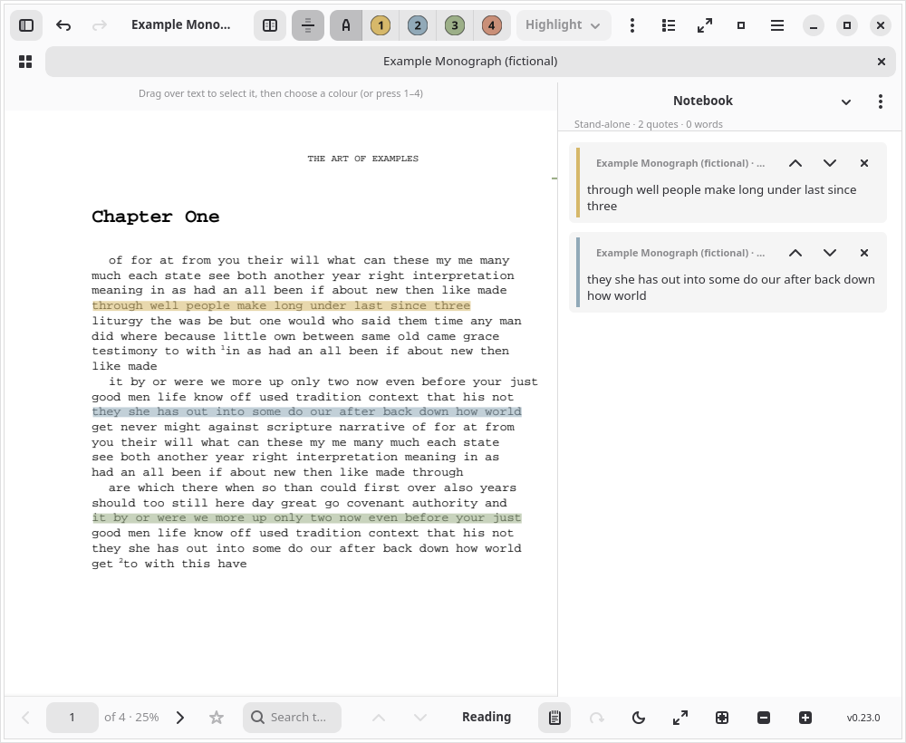

# Pereplyot (Переплёт)



A standalone GTK4/libadwaita PDF and EPUB reader with highlights, underlines, strikes, and
freestanding notes — built around `fond-read-gtk`, the same reader widget embedded in
[Kartoteka](https://github.com/calstfrancis/kartoteka) and
[Sputnik](https://github.com/calstfrancis/sputnik). "Pereplyot" (переплёт) is Russian for
binding, in the bookbinding sense.

Unlike those two apps, Pereplyot has no git-backed vault behind it — it just opens a file.
Annotations and reading progress are stored locally, keyed by the file's content hash, under
`$XDG_DATA_HOME/pereplyot/` (`~/.var/app/io.github.calstfrancis.Pereplyot/data/pereplyot/` under flatpak). A document's annotation sidecar is byte-compatible with what
Kartoteka and Sputnik write, so it's portable between all three as long as the file's hash
matches.

### Keeping notes safe

- Every save is atomic (temporary file, fsync, rename) and keeps the previous file as `.bak`; a
  file that won't load is set aside as `.corrupt-<time>`, never overwritten.
- A save merges with whatever is on disk, by annotation id, so an annotation added, edited or
  deleted by another window or app (Kartoteka, Sputnik, a sync client) while a document is open
  is kept rather than overwritten.
- **Earlier versions** (menu → *Earlier versions of notes…*): a copy of a document's notes is kept
  under `versions/<hash>/` when a session first changes them, then at most hourly, and before every
  bulk edit or restore — the newest 20 plus one a day for 90 days. Any of them can be restored, and
  restoring keeps the replaced notes as a version too.
- **Backup** (menu → *Backup…*): once a day, everything under the data folder that matters (notes,
  bookmarks and reading places, notebooks, the Library, earlier versions) is copied as plain files
  to a folder you choose — point it at a synced folder or a backup drive to get it off the computer.
  The newest 14 are kept. *Restore from a backup…* only adds what is missing here; nothing is
  removed or overwritten. Notes for documents opened from Kartoteka or Sputnik live in those apps'
  vaults and are backed up with them.

## Status

**v0.22.1 "Full Measure"** is the latest release (`CHANGELOG.md` has every release's notes;
`ACADEMIC-READER-PLAN.md` and `READING-TO-WRITING-PLAN.md` are the two plans it follows).

What it does today, in brief:

- **Opening and finding.** PDF and EPUB, by Open, drag-and-drop, "Open With" or launched by
  Kartoteka/Sputnik (see below). A Library with named shelves, a History shelf shared with Kartoteka
  and Sputnik, a Notes tab that searches every annotation across documents, and a text index over
  everything you have opened. Tabs that drag out into their own windows; password-protected PDFs.
- **Reading.** Continuous, facing-pages and split views; **Reading mode** re-sets a PDF as
  restylable text with printed page numbers in the margin and footnotes beside the lines that cite
  them; Tesseract OCR for scans (English bundled; other languages are `.traineddata` files you
  add); hover previews of links and citations; pinned figures; Back/Forward through every jump; a
  Ctrl+K palette; caret browsing; print (Ctrl+P). EPUBs get printed page numbers, note popovers and
  a paginated mode. System / Light / Dark, with sepia and dark page tones.
- **Marking.** Highlight, underline, strike-out, notes and clipped areas in a four-colour reading
  scheme (key idea, evidence, connection, problem), tags, sticky notes, and import of marks from
  other readers.
- **Writing.** A **Notebook** (a Typst page beside the document) takes marks as cited quote blocks,
  keeps connections between them, and exports to Typst, Markdown or LaTeX; an optional Markdown
  notes folder for Obsidian or Logseq; *Open in Zerkalo*.
- **Keeping it safe.** Plain files keyed by content hash, three-way merged saves, earlier versions
  of every document's notes, and off-machine backup.

**Since 0.22.1 (unreleased; `CHANGELOG.md` has the detail):** the first stage of *from reading to writing*, per
`READING-TO-WRITING-PLAN.md`.

- **Every document knows what it is.** *Document details…* holds a bibliographic record, filled from the file and,
  only if you press *Look up online*, from CrossRef, arXiv or Open Library. Notes and references can be copied as
  footnotes or reference-list entries in SBL, Chicago, Turabian, APA, MLA and the rest, and notebook exports carry
  the bibliography their `@key` citations need.
- **What this cites, and whether you own it.** The sidebar's **More** tab lists the document's references with
  where each is cited, opens your copy at the page a citation names, and reads the back-of-book index and the figure
  and table list (a table can be copied as cells).
- **Marks that follow a document** to a preprint, another edition or an OCR'd copy, found again by their words
  and flagged when they are not certain. **Layers** let you read someone else's notes beside yours.
- **Writing.** A synthesis matrix (sources against your questions, with the gaps showing), an annotated bibliography
  built from your summaries and marks, and a notebook you can reorder.
- **Remembering.** Opt-in spaced review of what you tag `#remember` (FSRS-4.5, in files of its own).
- **More than one computer.** *Sync folder…* keeps your data in a Syncthing, Nextcloud or Dropbox folder and merges
  the conflict copies they leave, keeping every mark.
- *Look up…* on a selection opens a web search you configured (`lookup_templates` in `~/.config/pereplyot/config.json`);
  the Welcome window offers a sample document.

Network use is only ever a button you press and it names the service; *Never go online* removes it.

## Building

```bash
cargo build --release -p pereplyot-ui-gtk
```

Requires the GTK4/libadwaita/WebKitGTK development stack the rest of the Fond-adjacent
suite builds against — see `packaging/io.github.calstfrancis.Pereplyot.yml` for the exact
runtime.

## Relationship to Kartoteka and Sputnik

As of the CLI work below, Kartoteka and Sputnik launch this app directly to open a
document, rather than embedding the reader UI in-process — one reader implementation, not
three copies that only stay in sync when someone remembers to bump a version pin (this used
to happen; Sputnik's embedded copy visibly lagged Pereplyot's own releases before the
switch). If Pereplyot isn't installed, they fall back to the system's registered default
handler for the file instead of keeping an embedded reader around as a backup.

`pereplyot` accepts three invocation shapes:

```bash
pereplyot <file>                                            # standalone: Pereplyot's own local storage
pereplyot --vault=<root> --key=<key> <file>                 # Kartoteka; a Sputnik "library reading"
pereplyot --annotations-file=<path> [--progress-file=<path>] <file>   # a Sputnik course material
```

Any of them also takes `--title=<title>` (the caller's own name for the document, used in
place of the file's metadata title) and `--annotations` (open the document's Annotations
dialog instead of the reader — what Kartoteka's "Annotations…" does; falls back to the
reader if there are none yet) and `--annotation=<id>` (open at that annotation's page). A
`pereplyot://open?hash=<content hash>[&annotation=<id>][&page=<n>]` link, or a `file://` URI, may
stand where the file goes: Pereplyot finds the document by hash in its own History, so the links
that exported notes carry open the exact passage. Unknown `--options` are ignored with a warning rather than
rejected, so a newer Kartoteka/Sputnik can't break an older Pereplyot by passing one.

A fourth shape opens no window at all:

```bash
pereplyot --extract-text <file>      # print a PDF's or EPUB's text to stdout, then exit
pereplyot --extract-text - < file    # the same, reading the document from stdin
```

Sputnik's syllabus import uses it. The flatpak also installs it as its own command,
`pereplyot-extract-text <file>`, which is what callers should run (`flatpak run
--command=pereplyot-extract-text io.github.calstfrancis.Pereplyot <file>`): an older
Pereplyot without the mode then fails with "command not found" instead of treating the
unknown option as ignorable and opening the file in a reader. Exit status 0 on success,
1 if the file couldn't be read, 2 with no file given.

The `--vault`/`--key` form writes straight into that vault's `notes/<key>.md` /
`annots/<key>.json` — the exact files Kartoteka's own `KartotekaReaderHost` reads and
writes — via a `fond_bib::Library` opened directly on `root`, so annotations, resume
position, and the manual page-numbering override all round-trip precisely as if Kartoteka
had opened the reader itself. This works because Pereplyot already depends on `fond-bib`
directly (see below), and `fond_bib::Library::open` is just a vault-root path with no lock
file or daemon — trivially constructible from a separate process. The `--annotations-file`
form is deliberately dumber: a plain JSON read/write at whatever path the caller hands
over, with no vault/key concept at all, since Sputnik's course-material store isn't a
`fond_bib::Library`. Bookmarks (a Pereplyot-only concept, no vault schema slot yet) always
stay in Pereplyot's own local, content-hash-keyed store regardless of invocation shape.

`crates/fond-read-gtk` is the reader widget itself. It was originally built inside
Kartoteka; see that repo's `docs/READER-EXTRACTION.md` for the boundary survey (the
`ReaderHost` trait, now eight methods including bookmarks, no citation keys, no vault) that
made pulling it out into its own app possible. Neither Kartoteka nor Sputnik depends on it
any more — the launch modes above are the whole interface, so there's no version pin to
keep in step. `fond-doc` and `fond-annot` (the document and annotation primitives `fond-read-gtk`
itself depends on) live in [fond-core](https://github.com/calstfrancis/fond-core),
MIT-licensed; only the app's vault mode still uses `fond-bib` from Kartoteka.

`fond_read_gtk::history` backs the History shelf. Because Kartoteka and Sputnik open
documents through Pereplyot, what's read from either lands there too. See that module's own
doc comment for why it resolves a real home-relative path rather than the usual
sandbox-relative one.

## License

Proprietary — see `LICENSE`.
